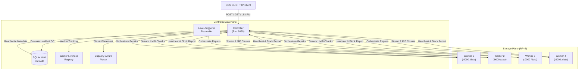
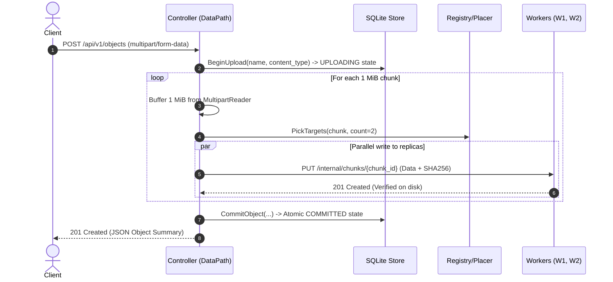
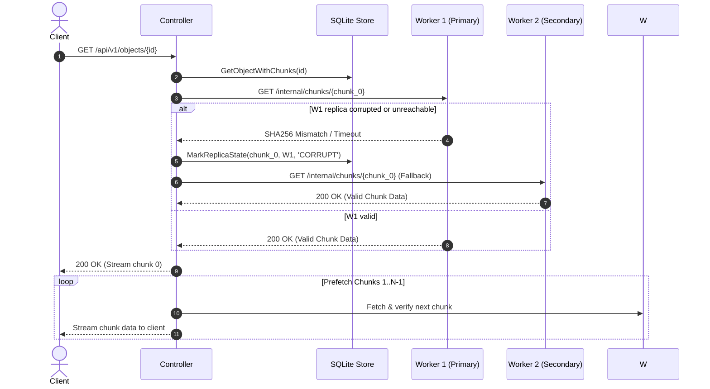

# Distributed Cloud Storage Architecture

## 1. System Overview

A fault-tolerant, horizontally scalable, multi-chunk distributed object store implemented in Go 1.26. It follows an HDFS/GFS-inspired centralized metadata architecture with autonomous storage workers, streaming chunk replication, and level-triggered self-healing. The repository currently targets Docker Compose for local operation; the controller is the public API boundary and workers are private storage services.

### 1.1 Architecture Diagram

---

## 2. Core Components

### 2.1 Controller (`cmd/controller`)
- **Metadata Store (`internal/controller/metadata`)**: SQLite embedded database operating with Write-Ahead Logging (`WAL`), `busy_timeout=5000ms`, and foreign keys enabled. Maintains `objects`, `chunks`, `chunk_replicas`, and `workers` tables.
- **Worker Registry (`internal/controller/registry`)**: In-memory worker tracker updated via periodic worker heartbeats (`HEARTBEAT_INTERVAL=2s`). Evaluates liveness transitions (`ALIVE` -> `SUSPECT` -> `DEAD`) and persists state changes to SQLite.
- **Placement Engine (`internal/controller/placement`)**: Selects optimal replica hosts. Excludes workers already hosting the chunk and sorts candidates by least used storage (`UsedBytes / Capacity`).
- **Data Path (`internal/controller/datapath`)**:
  - **Streaming Upload**: Consumes incoming `multipart/form-data` with standard `r.MultipartReader()`. Splits byte streams into 1 MiB chunks on the fly using pooled memory buffers (`sync.Pool`), streams replicas in parallel to candidate workers up to `UPLOAD_PARALLELISM`, verifies worker HTTP 201 responses, and executes an atomic SQLite commit upon final chunk receipt.
  - **Streaming Download**: Queries chunk replica topology, fetches and verifies Chunk 0 before sending HTTP 200 headers to the client, prefetches subsequent chunks (`DOWNLOAD_PREFETCH=2`), verifies SHA-256 integrity per chunk, and falls back to alternative replicas on corruption or worker timeouts.
- **Reconciler (`internal/controller/reconciler`)**: Autonomous, level-triggered background loop comparing desired state against actual cluster topology. Heals under-replicated chunks, trims over-replicated copies, purges corrupt replicas, and coordinates garbage collection for deleted objects.

### 2.2 Worker Nodes (`cmd/worker`)
- **Chunk Store (`internal/worker/chunkstore`)**: Checksummed on-disk storage managing chunk-ID-named files within two-level fanout directories (`/data/chunks/xx/chunk_id`). The IDs are not content hashes; the store uses SHA-256 metadata for integrity and shards paths by a hash of the ID. Writes are atomic and use temporary files plus fsync.
- **Background Scrubber (`internal/worker/scrubber`)**: Rate-limited background scanner verifying on-disk SHA-256 checksums against sidecar metadata files (`.meta`). Automatically quarantines corrupted chunks to `/data/quarantine/`.
- **Registrar (`internal/worker/registrar`)**: Handles cluster enrollment with exponential backoff and sends periodic heartbeats with disk utilization stats and quarantined chunk identifiers.

### 2.3 CLI Client (`cmd/ocs`)
Command-line interface implementing `cp`, `cat`, `ls`, `stat`, `meta`, `rm`, `status`, and `verify` commands with support for both human-readable progress output and machine-readable JSON.

---

## 3. End-to-End Request Flows

### 3.1 Streaming Upload Flow

### 3.2 Verified Streaming Download Flow

---

## 4. Architectural Decision Log (D1 - D17)

- **D1 (Language & Runtime)**: Implemented in Go 1.26 using native goroutines, channels, structured logging (`log/slog`), and standard library HTTP routing (`net/http`). Uses only small supporting dependencies for SQLite, UUIDs, and synchronization; it avoids a heavy web framework.
- **D2 (Controller Proxying vs Direct Transfers)**: The controller proxies data plane bytes. While direct client-to-worker presigned URLs minimize controller bandwidth, centralized proxying satisfies location transparency, simplifies firewall requirements, and centralizes access control.
- **D3 (Fixed 1 MiB Chunk Size)**: Standardized 1 MiB chunk boundaries simplify memory pool allocation, bound single repair transfer durations, and optimize SQLite chunk index cardinality.
- **D4 (SQLite in WAL Mode)**: Embedded SQLite provides ACID guarantees without requiring an external database cluster (e.g., PostgreSQL). Write-Ahead Logging allows concurrent readers while writes execute.
- **D5 (Replication Factor & Write Quorum)**: Configured with `REPLICATION_FACTOR=2` and synchronous write quorum `WRITE_ACKS=2`. A committed chunk has two acknowledged copies, but writes require enough healthy workers to satisfy that quorum; the system does not promise writes during every worker outage.
- **D6 (Liveness State Machine)**: Workers transition from `ALIVE` to `SUSPECT` after missing 3 heartbeats (6s) and to `DEAD` after 15s. Transitions are tracked in memory and recorded in SQLite.
- **D7 (Level-Triggered Reconciliation)**: Self-healing runs on a declarative, state-based reconciliation loop instead of edge-triggered messages. Resilient to dropped network packets, controller restarts, and transient disconnects.
- **D8 (Repair Grace Delay)**: Reconciler enforces `REPAIR_DELAY=5s` before scheduling repairs for chunks on `DEAD` workers. Prevents unnecessary data migration storms during brief container or service restarts.
- **D9 (Startup Grace Period)**: On controller boot, `STARTUP_GRACE=15s` by default suppresses repair actions to allow surviving workers to reconnect and report heartbeats. The local Compose file overrides this to `10s` to make demos start faster.
- **D10 (Bounded Memory Footprint)**: Objects are never buffered in whole memory. Chunks stream through pre-allocated 1 MiB buffer pools (`sync.Pool`), and active uploads are admitted via semaphores (`MAX_CONCURRENT_UPLOADS=16`).
- **D11 (Block-Report Inventory Sync)**: Periodic and on-registration inventory synchronization reconciles SQLite metadata with on-disk chunk inventory. Discovers silent bit loss, ad-hoc orphan chunks, and uncommitted uploads.
- **D12 (Two-Phase Object Lifecycle)**: Objects transition `UPLOADING` -> `COMMITTED` or `DELETING`. Incomplete or aborted uploads leave no visible objects to readers and are garbage collected.
- **D13 (End-to-End SHA-256 Verification)**: Checksums are computed and verified at every boundary: worker verifies ingest, scrubber verifies at rest, controller verifies during download and repair replication.
- **D14 (Zero Whole-Object Buffering)**: Streaming chunk pipeline writes Chunk 0 only after verification and streams chunks sequentially, ensuring constant memory overhead regardless of object size.
- **D15 (Least-Loaded Placement Strategy)**: Placer filters eligible nodes by available capacity and sorts them by tracked used bytes, with a random tie-breaker. Optimistic reservations prevent concurrent uploads from selecting the same apparent free capacity.
- **D16 (Safe Deletion & Garbage Collection)**: Object deletion immediately marks the metadata row as `DELETING`. The background GC asynchronously purges replicas from alive workers, cleans orphaned chunks, and cascades the database deletion.
- **D17 (Single Metadata Authority)**: A single SQLite-backed controller provides one authoritative object view and atomic metadata transitions. This keeps the project simple and consistent, but controller availability and metadata durability are not replicated.

---

## 5. Production Considerations & Scaling Limits

1. **Controller High Availability**: In production, replace single-node SQLite with a distributed Raft consensus engine (e.g., HashiCorp Serf/Raft or CockroachDB/etcd) to remove the single point of failure.
2. **Direct-to-Worker Transfers**: For petabyte-scale throughput, replace controller proxying with cryptographically signed transfer tokens (similar to S3 presigned URLs), allowing clients to stream directly to workers.
3. **Erasure Coding**: For storage efficiency at scale, implement Reed-Solomon $RS(4,2)$ or $RS(8,4)$ chunk encoding, reducing storage overhead from $2\times$ (RF=2) to $1.5\times$ while maintaining identical fault tolerance.
4. **Tenant Isolation & Security**: Add tenant namespaces, mTLS between all nodes, and role-based IAM policies.
